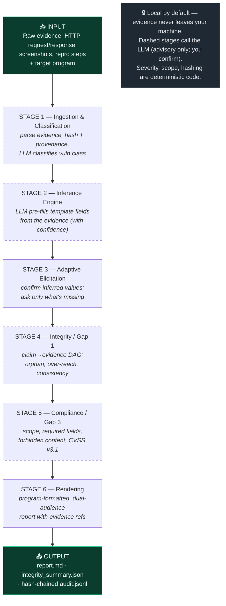
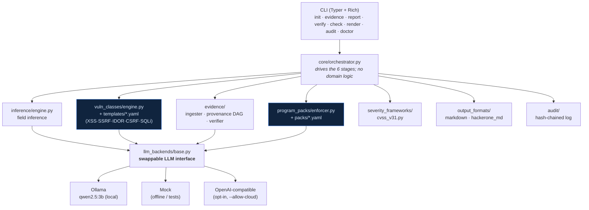

# ProofForge AI — Workflow & Architecture Diagrams

GitHub renders the Mermaid blocks below as images. To export a picture: open this file on GitHub
(or in VS Code with a Mermaid preview extension) and screenshot, or paste the Mermaid source into
<https://mermaid.live> and download an SVG/PNG.

---

## 1. The pipeline (what happens to your evidence)



**Legend:** dashed boxes (Stages 1, 2, 4, 5) invoke the LLM for a narrow sub-task; everything else is
deterministic Python. The LLM is always *advisory* — the researcher confirms every value.

---

## 2. Layered architecture (how the code is organized)



**Key design choice:** the LLM lives behind one small interface (`llm_backends/base.py`). Swapping
Ollama for a bigger model, the offline mock, or a future Claude/MCP backend is a new file — not a
refactor. Vulnerability classes and program rules are **data (YAML), not code**.

---

## 3. ASCII fallback (the pipeline)

```
            ┌─────────────────────────────────────────────┐
   INPUT    │ evidence (HTTP, screenshots, repro) + program│
            └───────────────────────┬─────────────────────┘
                                    ▼
   STAGE 1  Ingestion & Classification   parse · hash · classify (LLM)
                                    ▼
   STAGE 2  Inference Engine            LLM pre-fills fields + confidence
                                    ▼
   STAGE 3  Adaptive Elicitation        confirm inferred · ask the rest
                                    ▼
   STAGE 4  Integrity  (Gap 1)          claim→evidence DAG: orphan / over-reach (LLM)
                                    ▼
   STAGE 5  Compliance (Gap 3)          scope · required fields · CVSS v3.1
                                    ▼
   STAGE 6  Rendering                   program-formatted dual-audience report
                                    ▼
            ┌─────────────────────────────────────────────┐
   OUTPUT   │ report.md · integrity_summary.json · audit.jsonl (hash-chained)
            └─────────────────────────────────────────────┘

   Local by default · LLM advisory only (you confirm) · deterministic severity/scope/hashing
```
